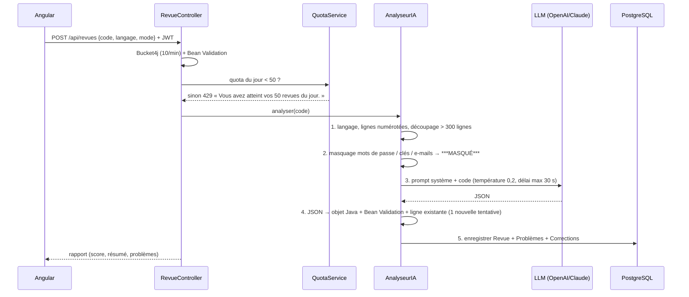

# RevIA — votre assistant intelligent de revue de code

> Mini-projet · Sujet 4 — Équipe : Nafissa Bridah · Rahma Kehrji · Housine Saihi · Aziz Eifa · Mustapha Sifaoui
>
> Application web (Angular + Spring Boot + PostgreSQL) où l'on colle son code et où l'IA le relit comme un développeur senior :
> elle détecte les bugs, les mauvaises pratiques et les failles de sécurité, puis propose une **correction expliquée**.

Ce document regroupe tout ce qu'il faut savoir : versions, installation, lancement, tests, architecture, choix techniques, conformité à la présentation `RevIA_Presentation_corrigee.pptx` et ce qui a été ajouté.

---

## Sommaire

1. [Démarrage rapide (2 minutes)](#1-démarrage-rapide-2-minutes)
2. [Versions utilisées](#2-versions-utilisées)
3. [Installation détaillée](#3-installation-détaillée)
4. [Utiliser et tester l'application](#4-utiliser-et-tester-lapplication)
5. [Architecture](#5-architecture)
6. [Diagramme de classes → code](#6-diagramme-de-classes--code)
7. [Module IA](#7-module-ia)
8. [Sécurité et règles du sujet](#8-sécurité-et-règles-du-sujet)
9. [API REST](#9-api-rest)
10. [Configuration (variables d'environnement)](#10-configuration-variables-denvironnement)
11. [Tests et rapport de tests](#11-tests-et-rapport-de-tests)
12. [Déploiement (Docker, Render, Vercel, CI)](#12-déploiement-docker-render-vercel-ci)
13. [Conformité à la présentation](#13-conformité-à-la-présentation)
14. [Ce qui a été ajouté ou adapté](#14-ce-qui-a-été-ajouté-ou-adapté)
15. [Structure du projet](#15-structure-du-projet)
16. [Dépannage](#16-dépannage)

---

## 1. Démarrage rapide (2 minutes)

Prérequis : **Java 17 ou plus** (Java 21 installé sur ce PC). Le JAR contient déjà le front-end.

```powershell
cd "C:\Users\NBridah\OneDrive - Linedata Services, Inc\Desktop\3SDE_2026-2027\AI\RevIA"
powershell -ExecutionPolicy Bypass -File scripts\start.ps1
```

Le navigateur s'ouvre ensuite sur **http://localhost:8085**. Sinon, ouvrez cette adresse vous-même.

| Compte | E-mail | Mot de passe | Rôle |
|---|---|---|---|
| Démo (23 revues déjà faites) | `sarra@revia.local` | `Sarra2026!` | Développeur |
| Administrateur | `admin@revia.local` | `Admin2026!` | Admin (utilisateurs, quotas, prompts) |

Vous pouvez aussi créer votre propre compte avec **S'inscrire**.

> **LLM utilisé = Google Gemini** dès qu'un fichier `.env` existe à la racine (il n'est jamais envoyé sur GitHub) :
> ```
> REVIA_AI_PROVIDER=gemini
> REVIA_AI_API_KEY=<votre clé Gemini>
> ```
> `scripts\start.ps1` le lit automatiquement.
>
> **Sans `.env` = mode `demo`** : il n'y a ni clé d'API ni Internet nécessaires. L'analyse est faite par un analyseur à règles local qui renvoie
> **exactement le même JSON qu'un LLM**. Pour utiliser un vrai LLM, voir [§ 3.4](#34-brancher-un-vrai-llm-gemini-recommandé). **LLM retenu : Google Gemini (`gemini-flash-lite-latest`), gratuit.**

Pour arrêter l'application, faites `Ctrl + C` dans la fenêtre PowerShell.

---

## 2. Versions utilisées

### Front-end

| Élément | Version | Présentation |
|---|---|---|
| Angular (core) | **17.3.12** | « Angular 17 · TypeScript » ✅ |
| Angular CLI | 17.3.17 | |
| TypeScript | 5.4.5 | ✅ |
| Angular Material / CDK | 17.3.10 | « Angular Material » ✅ |
| Angular Router | 17.3.12 | « Angular Router » ✅ |
| Monaco Editor (`ngx-monaco-editor-v2`) | 17.0.1 (monaco-editor 0.44.0) | « Monaco Editor (ngx-monaco-editor) » ✅ |
| ng2-charts / Chart.js | 6.0.1 / 4.5.1 | « ng2-charts (Chart.js) » ✅ |
| RxJS / zone.js | 7.8.2 / 0.14.10 | |
| Tests : Karma / Jasmine | 6.4.4 / 5.1.2 | |
| Node.js (build) | 22.17 sur ce PC (20 LTS en CI/Docker) | |

### Back-end

| Élément | Version | Présentation |
|---|---|---|
| Java (cible de compilation) | **17** (`<java.version>17`), exécuté ici sur JDK 21.0.10 | « Java 17 » ✅ |
| Spring Boot | **3.5.16** | « Spring Boot 3 » ✅ |
| Spring Security | 6.5.11 | ✅ |
| Spring AI | **1.1.8** (Gemini, Groq, Ollama, OpenAI, Anthropic/Claude) | « Spring AI · OpenAI ou Claude » ✅ (+ fournisseurs gratuits) |
| Spring Data JPA / Hibernate | 6.6.53.Final | ✅ |
| Bean Validation (Hibernate Validator) + Jackson | Jackson 2.21.4 | ✅ |
| JWT (jjwt) | 0.12.6 | « JWT » ✅ |
| BCrypt | Spring Security (coût 12) | ✅ |
| Bucket4j | 8.14.0 (`bucket4j_jdk17-core`) | « Bucket4j » ✅ |
| PostgreSQL (driver) | 42.7.11 | « PostgreSQL » ✅ (testé sur PostgreSQL 18.3) |
| Flyway (migrations) | 11.7.2 | *ajout* |
| H2 (profil dev uniquement) | 2.3.232 | *ajout* |
| Tomcat embarqué | 10.1.55 | |
| Tests : JUnit 5 · Mockito · MockMvc | via spring-boot-starter-test | « JUnit 5 · Mockito » ✅ |
| Maven | 3.9.9 | |

**Version de l'application : RevIA 1.0.0** (`revia.version` dans `application.yml`, et `GET /api/systeme/info`).

---

## 3. Installation détaillée

### 3.1 Prérequis

| Outil | Pourquoi | Vérifier |
|---|---|---|
| Java 17+ | exécuter / compiler le back-end | `java -version` |
| Maven 3.9+ | compiler le back-end | `mvn -v` |
| Node.js 20+ et npm | compiler le front-end | `node -v` |
| *(optionnel)* Docker Desktop | déploiement « prod » complet avec PostgreSQL | `docker version` |
| *(optionnel)* Google Chrome | tests front-end (Karma ChromeHeadless) | — |

Ces outils étaient déjà présents sur ce PC. Seul **Ollama** (optionnel, LLM local gratuit, port 11434) a été ajouté. Rien n'a été désinstallé ni reconfiguré : le PostgreSQL existant (port 5432), Oracle/PL-SQL et les autres applications n'ont pas été touchés. RevIA utilise le port **8085**, qui était libre.

### 3.2 Tout reconstruire (front + back, en un seul JAR)

```powershell
powershell -ExecutionPolicy Bypass -File scripts\build.ps1            # avec les tests
powershell -ExecutionPolicy Bypass -File scripts\build.ps1 -SkipTests # plus rapide
```

Le script fait trois choses :
1. `ng build --configuration production` ;
2. copie de `frontend/dist/frontend/browser` dans `backend/src/main/resources/static` ;
3. `mvn package`, qui produit `backend/target/revia.jar`.

### 3.3 Mode développement (deux serveurs, rechargement à chaud)

```powershell
# Terminal 1 - API sur http://localhost:8085 (profil dev : H2 + fournisseur demo + données de démo)
cd backend
mvn spring-boot:run

# Terminal 2 - Angular sur http://localhost:4200 (proxy /api -> 8085, voir proxy.conf.json)
cd frontend
npm install      # la première fois seulement
npx ng serve
```

En profil `dev`, la base H2 est stockée dans `REVIA_DATA_DIR`, ou par défaut dans `./data` (hors OneDrive avec `scripts/start.ps1` : `%LOCALAPPDATA%\RevIA\data`).
Pour repartir de zéro, supprimez ce dossier.

### 3.4 Brancher un vrai LLM (Gemini recommandé)

La fiche de l'atelier impose des **outils et des API gratuits**. Le LLM retenu est donc **Google Gemini** (`gemini-flash-lite-latest`), gratuit avec une clé créée sur [aistudio.google.com](https://aistudio.google.com) (*Get API key*). Spring AI l'appelle par son point d'accès compatible OpenAI.

La clé reste **côté serveur**, dans une variable d'environnement (ou le fichier `.env`, jamais versionné). Elle n'est jamais dans le code, ni dans le navigateur, ni sur GitHub.

```powershell
# Gemini (gratuit) - choix du projet
$env:REVIA_AI_PROVIDER = "gemini"
$env:REVIA_AI_API_KEY  = "<votre clé Gemini>"
powershell -ExecutionPolicy Bypass -File scripts\start.ps1
```

Autres fournisseurs possibles, sans changer le code :

| `REVIA_AI_PROVIDER` | Gratuit ? | Modèle par défaut | Clé |
|---|---|---|---|
| `gemini` ✅ choisi | oui | `gemini-flash-lite-latest` | aistudio.google.com |
| `groq` | oui | `llama-3.3-70b-versatile` | console.groq.com (`gsk_...`) |
| `ollama` | oui, 100 % local | `qwen2.5-coder:1.5b` | aucune (`ollama pull qwen2.5-coder:1.5b`) |
| `openai` | non | `gpt-4o-mini` | `sk-...` |
| `anthropic` | non | `claude-sonnet-5-5` | `sk-ant-...` |
| `demo` | oui, sans LLM | règles locales | aucune |

Pour un modèle local lent (Ollama sur CPU), augmentez le délai : `$env:REVIA_AI_TIMEOUT = "120"`.

```powershell
# OpenAI
$env:REVIA_AI_PROVIDER = "openai"
$env:REVIA_AI_API_KEY  = "sk-..."
$env:REVIA_AI_MODEL    = "gpt-4o-mini"        # optionnel (valeur par défaut)

# ou Claude (Anthropic)
$env:REVIA_AI_PROVIDER = "anthropic"
$env:REVIA_AI_API_KEY  = "sk-ant-..."
$env:REVIA_AI_MODEL    = "claude-sonnet-5-5"  # optionnel (valeur par défaut)

powershell -ExecutionPolicy Bypass -File scripts\start.ps1
```

Le modèle peut aussi être fixé dans `application.yml` (`revia.ai.model`), comme indiqué dans la présentation. Si le fournisseur demande une clé (`gemini`, `groq`, `openai`, `anthropic`) mais qu'elle est absente, l'application démarre quand même. L'erreur est **journalisée au démarrage**, et chaque analyse affiche « Service d'analyse indisponible. L'administrateur a été prévenu. ».

### 3.5 Production avec PostgreSQL (Docker)

```powershell
copy .env.example .env      # puis renseigner les secrets
docker compose up -d --build
# -> http://localhost:8080  (nginx + Angular, /api proxifié vers Spring Boot, PostgreSQL 16 non exposé)
```

Sans Docker, avec n'importe quel PostgreSQL :

```powershell
$env:SPRING_PROFILES_ACTIVE="prod"
$env:DATABASE_URL="jdbc:postgresql://localhost:5432/revia"; $env:DATABASE_USER="revia"; $env:DATABASE_PASSWORD="..."
$env:REVIA_JWT_SECRET="<48 caractères aléatoires>"; $env:REVIA_ADMIN_PASSWORD="..."
$env:REVIA_AI_PROVIDER="gemini"; $env:REVIA_AI_API_KEY="<clé Gemini>"
java -jar backend\target\revia.jar
```

Flyway crée lui-même les tables au premier démarrage (`db/migration/V1__schema_initial.sql`).

---

## 4. Utiliser et tester l'application

### 4.1 Parcours de test manuel (≈ 5 min)

| # | Action | Résultat attendu |
|---|---|---|
| 1 | Ouvrir http://localhost:8085 | Page de connexion aux couleurs de la présentation (RevIA, carte « Injection SQL détectée · ligne 3 », score 38) |
| 2 | Se connecter avec `sarra@revia.local` / `Sarra2026!` | Écran **Nouvelle revue**, barre latérale avec « Quota du jour » |
| 3 | Cliquer **Essayer avec un exemple**, puis **Lancer la revue** | Étapes d'analyse animées, puis rapport : score /100, résumé, badges « critiques / majeures / mineures », lignes marquées en couleur dans la marge de l'éditeur Monaco |
| 4 | Cliquer une carte de problème | L'éditeur se place sur la ligne |
| 5 | Filtres **Sécurité / Bug / Bonnes pratiques / Performance** | La liste est filtrée |
| 6 | **Voir la correction →** | Le pourquoi (problème + correction), le **diff avant/après** (rouge/vert), la référence OWASP, « Bon réflexe pour la suite », « Contexte envoyé au modèle » (lignes, langage, nombre de secrets masqués) |
| 7 | **Copier la correction**, **Marquer comme corrigé**, **Utile ? 👍**, **Faux positif** | Notification ; un faux positif ne compte plus dans le score |
| 8 | Modifier le code dans l'éditeur, puis **Relancer la revue** | Nouvelle revue « … (après correction) » dans l'historique |
| 9 | **Importer un fichier** (.java, .py, .js…) | Le code, le titre et le langage sont remplis automatiquement |
| 10 | **Historique** | Recherche, filtres langage / score / statut / période, pagination, menu ⋯ (ouvrir, supprimer), **Exporter en CSV** |
| 11 | **Tableau de bord** | Revues effectuées, problèmes détectés, score moyen + progression, corrections appliquées, courbe sur 30 jours, barres par catégorie, 3 problèmes récurrents |
| 12 | **Paramètres** | Modifier son nom, changer de mot de passe, voir le module IA (fournisseur, modèle, température 0,2, délai 30 s) |
| 13 | Se déconnecter, puis se connecter avec `admin@revia.local` / `Admin2026!` | **Utilisateurs & quotas** : changer le quota d'un développeur, bloquer un compte (déconnexion immédiate), versions du **prompt système** (créer / activer) |
| 14 | Coller un code vide, ou de plus de 2 000 lignes | « Collez entre 1 et 2 000 lignes de code. » |
| 15 | Mettre le quota d'un développeur à 1 (admin), puis lancer 2 revues | « Vous avez atteint vos 1 revues du jour. » (429) |

### 4.2 Lancer les tests automatiques

```powershell
cd backend;  mvn test                                           # 40 tests JUnit 5 / Mockito / MockMvc + jeu d'essai IA
cd frontend; $env:CHROME_BIN="C:\Program Files\Google\Chrome\Application\chrome.exe"
             npx ng test --watch=false --browsers=ChromeHeadless   # 14 tests Karma/Jasmine
```

Le rapport détaillé du jeu d'essai IA est écrit dans `backend/target/jeu-essai-rapport.md`.

---

## 5. Architecture

```mermaid
flowchart LR
    subgraph Navigateur
      A[Angular 17<br/>Monaco · Router · Material · ng2-charts]
    end
    subgraph Serveur["Back-end Spring Boot 3 · Java 17"]
      F[Filtres : JWT + Bucket4j] --> C[Contrôleurs REST]
      C --> S[Services métier<br/>Revue · Quota · Tableau de bord · Admin]
      S --> IA[AnalyseurIA<br/>préparation → masquage → appel → validation]
      S --> R[(Spring Data JPA)]
      E[@RestControllerAdvice] -.-> C
    end
    A -- "REST · JSON + JWT" --> F
    IA -- "HTTPS (Spring AI)" --> L[API LLM<br/>Gemini (gratuit)<br/>ou Groq, Ollama, OpenAI, Claude]
    IA -. "mode demo" .-> D[Analyseur à règles local]
    R --> P[(PostgreSQL<br/>H2 en dev)]
```

- **Angular ne parle qu'à notre back-end Spring.** La clé d'API ne quitte jamais le serveur.
- Le **front-end est servi par le même JAR** (dossier `static/`) en local. En production, il est servi par nginx (Docker) ou Vercel.
- **API sans état** : chaque requête porte un JWT. Le compte est relu en base à chaque requête : un compte bloqué perd l'accès immédiatement.
- **Base de données** : le schéma est versionné par Flyway et validé par Hibernate (`ddl-auto: validate`). Les requêtes sont paramétrées (JPA / Criteria).

### Déroulement d'une revue



---

## 6. Diagramme de classes → code

Toutes les classes du diagramme (diapo 8) existent, avec leurs attributs, leurs méthodes et leurs associations (`backend/src/main/java/com/revia/domain` et `ai`).

| Classe (diapo 8) | Fichier | Attributs / méthodes implémentés |
|---|---|---|
| `Utilisateur {abstract}` | `domain/Utilisateur.java` | nom, email `{unique}`, motDePasseHash, creeLe · `modifierProfil()` · `seConnecter(email, mdp) : String` → `AuthService.seConnecter` (renvoie le JWT). Héritage JPA `SINGLE_TABLE`. |
| `Developpeur` | `domain/Developpeur.java` | quotaJournalier, revuesDuJour (calculé) · `soumettreCode(...) : Revue` · `quotaAtteint()` |
| `Administrateur` | `domain/Administrateur.java` | `definirQuota(dev, n)` · `bloquerCompte(u)` · `gererUtilisateurs()` → `AdminService` |
| `AnalyseurIA` | `ai/AnalyseurIA.java` | fournisseur, modele, temperature = 0.2, timeoutSec = 30 · `analyser(code, langage)` · masquage via `MasqueurDonnees` |
| `PromptSysteme` | `domain/PromptSysteme.java` | version, contenu, actif · `construire(langage, ...)`. Association « utilise » 1 → 1..* (versions, une seule active) |
| `Revue` | `domain/Revue.java` | titre, langage, code, score `{0..100}`, creeLe · `calculerScore()` · `exporterCSV()` |
| `Probleme` | `domain/Probleme.java` | ligne, categorie, gravite, explication, fauxPositif · `signalerFauxPositif()` |
| `Correction` | `domain/Correction.java` | codeAvant, codeApres, justification, copiee · `copier()` |
| `« enumeration » Gravite` | `domain/Gravite.java` | CRITIQUE, MAJEURE, MINEURE, INFO |
| `TableauDeBord` | `domain/TableauDeBord.java` | scoreMoyen, nbRevues, erreursFrequentes · `calculer()` |
| `{contrainte}` | `RevueRepository`, `ProblemeRepository` | « Un développeur ne voit que ses propres revues » : **toutes** les requêtes filtrent sur l'auteur (testé : 404 sur la revue d'un autre) |

Associations : Developpeur 1 —soumet→ 0..* Revue · Revue 1 ◆—contient→ 0..* Probleme (composition, cascade) · Probleme 1 ◆—propose→ 0..1 Correction · Developpeur 1 —consulte— 1 TableauDeBord · AnalyseurIA «crée» Revue.

**Score** (`Revue.calculerScore`) : 100 − 20 par critique − 6 par majeure − 2 par mineure (info = 0), borné à 0..100. Les faux positifs ne comptent pas. Exemple de la maquette : 2 critiques + 3 majeures + 3 mineures = **36/100** (la maquette affiche 38 ; c'est le même ordre de grandeur, et le calcul est déterministe côté serveur).

---

## 7. Module IA

### 7.1 Les 5 étapes (diapo 9)

| Étape | Implémentation |
|---|---|
| 01 Préparation | `PreparateurCode` : langage choisi, ou détecté (extension du titre, puis contenu) ; lignes numérotées `12 \| code` ; **découpage par blocs de 300 lignes** avec la numérotation globale |
| 02 Masquage | `MasqueurDonnees` : mots de passe, secrets, jetons, clés (OpenAI, Anthropic, AWS, GitHub, Stripe, Google, Slack, JWT, clés privées), mots de passe dans les URL et chaînes JDBC, `getConnection(url, user, "mdp")`, **e-mails** → `***MASQUÉ***`. Le nombre de lignes est conservé |
| 03 Appel au LLM | `SpringAiLlmClient` (ChatClient Spring AI) : prompt système + code, **température 0,2**, **délai max 30 s** (lecture HTTP + `CompletableFuture` annulé), une nouvelle tentative différée de 2 s si le fournisseur renvoie une erreur 5xx |
| 04 Validation | JSON → `ReponseIA` (record Java) → **Bean Validation** (score 0..100, champs obligatoires, tailles), gravité / catégorie normalisées, **ligne citée existante** (sinon le problème est rejeté et compté). JSON invalide → **1 nouvelle tentative automatique** |
| 05 Restitution | `RevueService` enregistre Revue + Problèmes + Corrections en une transaction, puis renvoie le rapport |

### 7.2 Prompt système (diapo 10)

Fichier `backend/src/main/resources/prompts/revue-system.st`. Il reprend mot pour mot le texte de la diapo 10, complété par le format JSON exact attendu. Il est stocké en base comme version `v1` : l'administrateur peut publier une `v2`, puis activer l'une ou l'autre, sans redéployer. Une base créée avant la mise à jour du prompt garde son ancienne version active : il suffit de publier le contenu du fichier comme nouvelle version (c'est ce qui a été fait sur la base locale de démonstration : version `v4` active).

Parades aux pièges de la diapo 10 :
- texte libre → format JSON imposé, extraction de l'objet JSON (même entouré de \`\`\`json) et validation ;
- problèmes inventés → « N'invente aucun problème » ;
- mauvaise ligne citée → lignes numérotées + rejet des lignes inexistantes.

### 7.3 Fournisseurs

| `REVIA_AI_PROVIDER` | Modèle par défaut | Remarque |
|---|---|---|
| `gemini` | `gemini-flash-lite-latest` | **LLM retenu (gratuit)**. Spring AI `OpenAiChatModel` sur le point d'accès compatible OpenAI de Google, réponse forcée en JSON (`response_format`), profil prod par défaut |
| `groq` | `llama-3.3-70b-versatile` | Gratuit, compatible OpenAI |
| `ollama` | `qwen2.5-coder:1.5b` | Gratuit et local (http://localhost:11434), aucune clé |
| `openai` | `gpt-4o-mini` | Spring AI `OpenAiChatModel` |
| `anthropic` | `claude-sonnet-5-5` | Spring AI `AnthropicChatModel` |
| `demo` | `revia-regles-statiques-1.0` | **Ajout** : analyseur à règles local (≈ 25 règles : injection SQL, secrets en dur, ressources non fermées, bornes de boucle, XSS, eval, injection de commande, hachage faible, aléatoire non sûr, exception ignorée, `==` sur chaînes, `gets`/`strcpy`, `malloc`, division par zéro, déréférencement de null, `return null`, `SELECT *`, `==` en JS, variable inutilisée…). Il renvoie le même JSON (avec diff de correction) et passe par la même validation. Les rapports sont **rédigés comme par un relecteur** (`RedacteurRevue`) : la méthode concernée est citée (« Dans findUser(), … »), les problèmes sont hiérarchisés et le résumé dit par quoi commencer. Le texte est déterministe : même code, même rapport. Profil dev par défaut. |

---

## 8. Sécurité et règles du sujet

| Règle (diapo 11 + annexe) | Implémentation | Testé par |
|---|---|---|
| **Données masquées** avant le LLM | `MasqueurDonnees` (étape 2) | `MasqueurDonneesTest` (7 tests), `AnalyseurIATest.messageEnvoye` |
| **Sortie validée** | Bean Validation + ligne existante + gravité / catégorie connues | `AnalyseurIATest` |
| **Erreurs d'API gérées** | `AnalyseurIA.traduire` + `GlobalExceptionHandler` (`@RestControllerAdvice`) | `ErreursApiTest`, `AnalyseurIATest` |
| Clé côté serveur | variable d'environnement, jamais exposée (`/api/systeme/info` ne renvoie que fournisseur et modèle) | `ApiIntegrationTest.systeme` |
| Quotas & limitation | 50 revues / jour / utilisateur (en base, refus **avant** l'appel au LLM) + Bucket4j : 10 analyses / min / utilisateur, 10 connexions / min / IP | `ApiIntegrationTest.quotaEtAdmin`, `ErreursApiTest.debit` |
| Comptes protégés | Spring Security, **BCrypt (coût 12)**, **JWT HS256 de 2 h**, compte bloqué → refus immédiat, comparaison à temps constant à la connexion | `ApiIntegrationTest` |
| Isolation des données | un développeur ne voit que ses revues (404 sinon) ; `/api/admin/**` réservé au rôle ADMIN (403) | `ApiIntegrationTest.isolation` |
| Divers | CSRF inutile (API sans état, en-tête Bearer), CORS limité au front, en-têtes `X-Frame-Options` / `nosniff` / `Referrer-Policy`, export CSV protégé contre l'injection de formules Excel, pas de trace technique dans les réponses (`include-stacktrace: never`) | `RevueTest.csv` |

### Messages d'erreur (annexe, diapo 19)

| Situation | HTTP | Message affiché |
|---|---|---|
| Délai dépassé (> 30 s) | 504 | « L'analyse prend plus de temps que prévu. Réessayez dans un instant. » — le code est conservé dans l'éditeur |
| Quota du fournisseur atteint (429) | 503 | « Le service d'analyse est très sollicité. Réessayez dans une minute. » |
| Clé d'API absente ou invalide | 503 | « Service d'analyse indisponible. L'administrateur a été prévenu. » (journalisé dès le démarrage) |
| Réponse JSON invalide | 502 | une nouvelle tentative automatique, puis « Analyse incomplète : la réponse de l'IA n'a pas pu être validée. Réessayez. » |
| Quota utilisateur atteint | 429 | « Vous avez atteint vos 50 revues du jour. » |
| Code vide ou trop long | 400 | « Collez entre 1 et 2 000 lignes de code. » (contrôle côté Angular **et** côté Spring) |
| Trop de requêtes (Bucket4j) | 429 | « Trop de demandes en peu de temps. Réessayez dans N s. » + en-tête `Retry-After` |

---

## 9. API REST

Toutes les routes `/api/**` exigent `Authorization: Bearer <jwt>`, sauf mention contraire.

| Méthode | Route | Rôle |
|---|---|---|
| POST | `/api/auth/register` | S'inscrire *(public)* |
| POST | `/api/auth/login` | S'authentifier *(public)* → `{token, expireDansSecondes, utilisateur}` |
| GET / PUT | `/api/me` | Profil (quota du jour inclus) / modifier son nom |
| PUT | `/api/me/mot-de-passe` | Changer de mot de passe |
| POST | `/api/revues` | Soumettre un extrait `{titre?, langage, code, mode}` → rapport |
| GET | `/api/revues?q=&langage=&scoreMin=&scoreMax=&statut=&jours=&page=&taille=` | Historique paginé |
| GET | `/api/revues/export.csv?...` | Exporter l'historique (CSV UTF-8, `;`) |
| GET / DELETE | `/api/revues/{id}` | Rapport / suppression |
| POST | `/api/problemes/{id}/faux-positif` · `/corrige` · `/utile` | `{valeur: true\|false}` |
| POST | `/api/problemes/{id}/correction/copie` | Copier une correction |
| GET | `/api/tableau-de-bord?jours=30` | Statistiques |
| GET | `/api/admin/utilisateurs` | *(ADMIN)* liste + consommation |
| PUT | `/api/admin/utilisateurs/{id}/quota` · `/blocage` | *(ADMIN)* |
| GET / POST / PUT | `/api/admin/prompts` · `/api/admin/prompts/{id}/activer` | *(ADMIN)* versions du prompt |
| GET | `/api/systeme/info` · `/actuator/health` | *(public)* version, fournisseur, état |

---

## 10. Configuration (variables d'environnement)

| Variable | Défaut | Rôle |
|---|---|---|
| `SPRING_PROFILES_ACTIVE` | `dev` | `dev` (H2 + démo) ou `prod` (PostgreSQL) |
| `PORT` | `8085` | Port HTTP |
| `REVIA_AI_PROVIDER` | `demo` (dev) / `gemini` (prod) | `gemini`, `groq`, `ollama`, `openai`, `anthropic`, `demo` |
| `REVIA_AI_MODEL` | *(vide)* | Modèle, ex. `gemini-flash-lite-latest`, `llama-3.3-70b-versatile` |
| `REVIA_AI_TIMEOUT` | `30` | Délai max d'une analyse, en secondes |
| `REVIA_AI_API_KEY` | *(vide)* | Clé du fournisseur (ou `OPENAI_API_KEY` / `ANTHROPIC_API_KEY`) |
| `REVIA_AI_BASE_URL` | *(vide)* | URL compatible OpenAI (proxy, Ollama distant…) |
| `DATABASE_URL` / `DATABASE_USER` / `DATABASE_PASSWORD` | `jdbc:postgresql://localhost:5432/revia` / `revia` | PostgreSQL (prod) |
| `DATABASE_HOST` / `DATABASE_PORT` / `DATABASE_NAME` | `localhost` / `5432` / `revia` | Alternative à `DATABASE_URL` (utilisée par Render) |
| `REVIA_JWT_SECRET` | aléatoire en dev, **obligatoire en prod** (≥ 32 caractères) | Signature des JWT |
| `REVIA_JWT_MINUTES` | `120` | Durée de validité du jeton |
| `REVIA_ADMIN_EMAIL` / `REVIA_ADMIN_PASSWORD` | `admin@revia.local` / `Admin2026!` en dev | Administrateur créé au premier démarrage |
| `REVIA_QUOTA_JOUR` | `50` | Revues par jour (valeur par défaut des nouveaux comptes) |
| `REVIA_ANALYSES_MINUTE` / `REVIA_CONNEXIONS_MINUTE` | `10` / `10` | Limitation de débit Bucket4j |
| `REVIA_CORS_ORIGINS` | `http://localhost:4200` | Origines autorisées (front séparé) |
| `REVIA_DATA_DIR` | `./data` | Dossier de la base H2 (dev) |

Les autres réglages (`temperature 0.2`, `timeout-sec 30`, `max-lines 2000`, `chunk-lines 300`, `json-retries 1`) se trouvent dans `application.yml`, sous `revia.ai`.

---

## 11. Tests et rapport de tests

Exécutés les **16 et 17/10/2026** sur ce PC (Windows 11, JDK 21.0.10, Node 22.17, Chrome 155).

### 11.1 Synthèse

| Campagne | Outil | Résultat |
|---|---|---|
| Tests unitaires back-end | JUnit 5 + Mockito | **31 / 31 ✅** |
| Tests d'API | MockMvc (Spring Boot Test, H2) | **11 / 11 ✅** |
| **Total back-end** | `mvn test` | **42 / 42 ✅** (BUILD SUCCESS) |
| Tests front-end | Karma + Jasmine (Chrome Headless) | **14 / 14 ✅** |
| Jeu d'essai IA (diapo 15), fournisseur demo | `JeuEssaiIATest` | **20 / 20 défauts détectés (100 %)**, objectif ≥ 85 % ✅ · **0 / 3 faux positif** sur les extraits sains, objectif ≤ 1/3 ✅ |
| **Jeu d'essai IA avec le vrai LLM Gemini** (`gemini-flash-lite-latest`, gratuit) | API RevIA de bout en bout | **19 / 20 défauts détectés (95 %)** ✅ · **0 / 3 faux positif** ✅ · 0 erreur · **1,5 s** par analyse ([rapport](docs/rapport-jeu-essai-gemini.md)) |
| CI GitHub Actions | à chaque push sur https://github.com/nafissabridah/RevIA | ✅ back-end, front-end, **build des 2 images Docker** |
| Build de production Angular | `ng build` | ✅ 661 kB initial (173 kB transférés) |
| Test de bout en bout dans un navigateur réel | Chrome headless (Playwright) | ✅ connexion, revue, correction, historique, tableau de bord, nouvelle revue via l'UI, administration — **0 erreur console, 0 requête en échec** |
| Profil **prod sur PostgreSQL 18.3** | instance temporaire isolée (port 5433, supprimée ensuite) | ✅ migration Flyway, validation du schéma, inscription, revue enregistrée (8 problèmes, 8 corrections), tableau de bord, clé absente → 503 avec le bon message |

### 11.2 Détail des tests back-end

| Classe | Tests | Ce qui est vérifié |
|---|---|---|
| `MasqueurDonneesTest` | 7 | mot de passe en constante · clés OpenAI/AWS/GitHub/Stripe · e-mails · chaîne JDBC / URL / `getConnection` · numérotation conservée · pas de faux positif sur une concaténation `"mdp=" + x` · idempotence |
| `AnalyseurIATest` | 10 | JSON valide (même entre \`\`\`json) et normalisé · code envoyé numéroté **et** masqué · JSON invalide → nouvelle tentative · invalide 2 fois → 502 · gravité inconnue refusée · ligne inexistante rejetée · **timeout → 504** · **429 fournisseur → 503** · clé invalide ou absente → 503 · découpage > 300 lignes |
| `RevueTest` | 6 | calcul du score (36 pour 2C+3M+3m) · faux positif · statuts · CSV + anti-injection de formule · quotas · normalisation |
| `JeuEssaiIATest` | 1 | 20 + 3 extraits, 5 langages (rapport `target/jeu-essai-rapport.md`, avec le texte rédigé de chaque rapport) |
| `LlmConfigTest` | 2 | fournisseurs gratuits (Gemini, Groq, Ollama) : modèle par défaut, clé obligatoire sauf Ollama · `demo` · fournisseur inconnu refusé |
| `RedacteurRevueTest` | 5 | résumé rédigé (méthode citée, « Je commencerais par… », pas de compteur mécanique) · formatage Python `% (login, empreinte)` · code sain · détection de la méthode englobante (Java, Python, JS) · même code → même rapport |
| `ApiIntegrationTest` | 7 | **401** sans jeton ou avec un jeton falsifié · inscription / connexion / **409** / mauvais mot de passe / **400** validation · création de revue (injection SQL ligne 4, correction `prepareStatement`) + historique + CSV + tableau de bord + faux positif (score +20) + copie + suppression · **isolation 404 / 403** · **400 code vide / > 2 000 lignes** · **quota 429** + admin (quota, blocage → 401 immédiat) · santé + info sans clé |
| `ErreursApiTest` | 4 | **504** délai dépassé (aucune revue enregistrée) · 503 quota fournisseur + 502 JSON invalide · 503 clé absente · **429 Bucket4j + Retry-After** |

### 11.3 Jeu d'essai IA (diapo 15)

| Type | Extraits | Langages | Détectés |
|---|---|---|---|
| Injection SQL | 4 | Java, PHP, Python | 4/4 |
| Secrets en dur | 3 | Java, JS, Python | 3/3 |
| Ressources non fermées | 3 | Java, C | 3/3 |
| Erreurs de bornes | 4 | C, Java, Python | 4/4 |
| XSS | 3 | JS, TS, PHP | 3/3 |
| Autres (null, division, `==`) | 3 | Java, JS | 3/3 |
| Extraits sains (témoins) | 3 | Java, JS, Python | 0 faux positif |

Les extraits sont dans `backend/src/main/resources/jeu-essai/` (avec `manifest.json`). Ces chiffres concernent le **fournisseur demo**. Le même jeu d'essai a été rejoué avec le **vrai LLM Gemini** : **19 / 20 (95 %)** et **0 / 3 faux positif** (détail : [docs/rapport-jeu-essai-gemini.md](docs/rapport-jeu-essai-gemini.md)).

Deux constats pendant ces essais :
- `gemini-flash-latest` est limité à **20 requêtes par jour** en offre gratuite (quota atteint pendant le test, RevIA a bien affiché « Le service d'analyse est très sollicité »). Le modèle retenu est donc **`gemini-flash-lite-latest`** : gratuit, plus rapide (1,5 s) et aussi précis sur ce jeu d'essai.
- Le masquage cachait les mots de passe au LLM, qui ne signalait plus les secrets en dur (17/20 au premier essai). Le prompt indique maintenant qu'une valeur `***MASQUÉ***` écrite dans le code est un secret en dur : 18/20, puis 19/20 avec la consigne « français correct » (le petit modèle déformait parfois le mot « externaliser »).

### 11.4 Défauts trouvés et corrigés pendant les tests

1. Le masquage ne reconnaissait pas une variable nommée exactement `password` ou `apiKey` (un préfixe était exigé). Corrigé et couvert par un test.
2. `"mdp=" + rs.getString(...)` était pris pour un mot de passe en dur. Corrigé et couvert par un test.
3. `getElementById(...)` déclenchait un « déréférencement de null » trop bavard sur du JavaScript. La règle est maintenant limitée à `find/get`.
4. Correctifs mineurs de mise en forme des corrections proposées (espaces, parenthèses).
5. En Python, `"... '%s' ..." % (login, x)` citait la variable « s » au lieu de « login » et produisait une requête corrigée incorrecte → corrigé et couvert par un test.
6. Avec Gemini, les secrets masqués n'étaient plus signalés → prompt système complété (voir § 11.3).
7. Render : l'URL de la base devait être recopiée à la main → elle est maintenant construite automatiquement (`DATABASE_HOST` / `DATABASE_PORT` / `DATABASE_NAME`).

### 11.5 Captures (navigateur réel)

`docs/captures/` : `01_connexion.png` · `02_revue.png` · `03_correction.png` · `04_historique.png` · `05_tableau.png` · `06_nouvelle_revue.png` · `07_admin.png`.

---

## 12. Déploiement (Docker, Render, Vercel, CI)

| Fichier | Rôle |
|---|---|
| `backend/Dockerfile` | build Maven, puis image JRE 17 Alpine, utilisateur non root, healthcheck `/actuator/health` |
| `frontend/Dockerfile` + `frontend/nginx.conf` | build Angular, puis nginx (SPA + proxy `/api`) |
| `docker-compose.yml` | PostgreSQL 16 (non exposé) + back-end + front-end sur http://localhost:8080 |
| `render.yaml` | Blueprint Render : API Spring Boot (Docker) + base PostgreSQL managée |
| `frontend/vercel.json` | Angular sur Vercel, `/api/*` réécrit vers l'API Render |
| `.github/workflows/ci.yml` | à chaque push : `mvn verify`, tests Karma, build Angular, build des 2 images Docker ; le rapport du jeu d'essai est publié dans le résumé de l'exécution |
| `.env.example` | Modèle des secrets |

Mise en ligne (ces étapes demandent **vos** comptes) :
1. ✅ **GitHub** : le code est sur https://github.com/nafissabridah/RevIA. La CI (tests back + front, build Angular, build des 2 images Docker) est **verte**.
2. **Render** : New → Blueprint → choisir le dépôt `RevIA`. La base PostgreSQL et le secret JWT sont créés automatiquement. Il reste à saisir `REVIA_ADMIN_PASSWORD`, `REVIA_AI_PROVIDER=gemini` et `REVIA_AI_API_KEY` (clé Gemini).
3. **Vercel** : importer le dépôt, *Root Directory* = `frontend`, et adapter l'URL Render dans `vercel.json`. Mettre l'URL Vercel dans `REVIA_CORS_ORIGINS` côté Render.

---

## 13. Conformité à la présentation

| Exigence (diapo 17) | Réponse | État |
|---|---|---|
| Application web front-end + back-end | Angular 17 + Spring Boot 3 + PostgreSQL | ✅ **Réalisé** |
| Module d'IA appliqué au génie logiciel | Revue de code automatique par LLM (Spring AI) | ✅ Réalisé |
| Présentation des prompts / modèles IA | Prompt système versionné + format JSON + modèle configurable | ✅ Réalisé |
| Pas de données personnelles brutes au LLM | Masquage des secrets et des e-mails avant envoi | ✅ Réalisé + testé |
| Sortie validée avant affichage | Bean Validation + contrôle des numéros de ligne | ✅ Réalisé + testé |
| Erreurs d'API : timeout, quota, clé absente | Messages clairs, code conservé | ✅ Réalisé + testé |
| Code source versionné (GitHub) | https://github.com/nafissabridah/RevIA + CI GitHub Actions | ✅ **Poussé, CI verte** |
| Démonstration dans le navigateur, déployée | Démo locale avec Gemini ✅ · images Docker construites par la CI ✅ · Render / Vercel prêts | ⚠️ Mise en ligne : un clic avec **votre** compte Render / Vercel (§ 12) |
| Rapport technique | Ce README (architecture, frameworks, API, modèles IA, prompts, tests) | ✅ |

Fiche de l'atelier « AI App Studio » (ESPRIT, IA for Software Engineering) :

| Exigence de la fiche | Dans RevIA | État |
|---|---|---|
| Mini application web qui appelle une **API d'IA gratuite** | Google Gemini (`gemini-flash-lite-latest`), offre gratuite | ✅ |
| Clé API **côté serveur**, dans `.env`, jamais dans le code ni le navigateur | `.env` lu par `start.ps1` / variables d'environnement ; `/api/systeme/info` ne renvoie jamais la clé | ✅ |
| `.env` jamais envoyé sur GitHub | `.gitignore` (vérifié : absent du dépôt) | ✅ |
| Tests avec mocks, sans appeler la vraie API | 42 tests JUnit 5 / Mockito / MockMvc + 14 tests Karma | ✅ |
| Solution de secours si l'API ne répond pas | messages clairs (délai, quota, indisponible) + mode `demo` sans LLM | ✅ |
| Git et GitHub | https://github.com/nafissabridah/RevIA, CI verte | ✅ |
| Démonstration de l'application en fonctionnement | `scripts\start.ps1` → http://localhost:8085 | ✅ |
| Kit Python / Streamlit | la fiche autorise sa propre technologie web : Angular + Spring Boot (imposés par la présentation) | ✅ |

Cas d'utilisation (diapo 5) : s'inscrire ✅ · s'authentifier ✅ · soumettre un extrait ✅ · analyser le code par l'IA (avec masquage et validation JSON inclus) ✅ · consulter le rapport ✅ · copier une correction ✅ · signaler un faux positif ✅ · consulter son historique ✅ · exporter l'historique (CSV) ✅ · suivre son tableau de bord ✅ · gérer utilisateurs & quotas (admin) ✅.

Maquettes (diapos 12 à 14) : barre latérale bleu nuit (Nouvelle revue / Historique avec compteur / Tableau de bord / Paramètres / Quota du jour / avatar), éditeur sombre avec marqueurs de marge par gravité, anneau de score, résumé, filtres « Tous · Sécurité · Bugs · Bonnes pratiques », cartes de problèmes « Voir la correction → / Faux positif ? », page de correction (liste des problèmes, OWASP, diff rouge/vert, Copier / Marquer comme corrigé / Utile ? / Faux positif, « Bon réflexe pour la suite », « Contexte envoyé au modèle », Précédent / Suivant), historique (recherche, filtres, barre de score, statut, export, pagination), tableau de bord (4 indicateurs, courbe, barres par catégorie, 3 récurrents, « Bonjour Sarra 👋 »). Couleurs : indigo `#5b5bf6`, accent « IA » `#a5b4fc`, fond `#0f1222`, gravités rouge / orange / jaune.

---

## 14. Ce qui a été ajouté ou adapté

**Ajouts** (absents de la présentation, nécessaires pour que l'application soit exploitable) :
- **Fournisseur `demo`** : analyseur à règles local, pour faire la démonstration et lancer les tests sans clé d'API ni Internet ;
- **Profil `dev` avec H2**, pour démarrer sans installer de base de données, et **Flyway** pour versionner le schéma PostgreSQL ;
- **Versions du prompt système** gérées par l'administrateur (créer / activer) ;
- **Données de démonstration** : compte « Sarra A. » avec 23 revues réparties sur 30 jours ;
- **Mode d'analyse** (Sécurité + qualité / Sécurité seule / Qualité seule), **import de fichier**, **brouillon conservé** dans le navigateur, **« Marquer comme corrigé »**, **« Utile ? »**, suppression d'une revue ;
- **Changement de mot de passe**, **limitation des connexions par IP**, protection CSV, en-têtes de sécurité ;
- Scripts `build.ps1` / `start.ps1`, Docker Compose, Render, Vercel, CI GitHub Actions.

**Adaptations** (choix assumés) :
- Diapo 10 : le champ `correction` du JSON est un **objet** `{codeAvant, codeApres, justification}` au lieu d'une chaîne, pour afficher le diff avant / après de la diapo 13.
- **Score** : il est recalculé côté serveur à partir des gravités, ce qui le rend déterministe et cohérent avec les faux positifs. Le score proposé par le LLM n'est pas affiché tel quel.
- Diagramme de **classes** : `Administrateur` hérite de `Utilisateur` ; diagramme de **cas d'utilisation** : l'administrateur hérite du développeur. Les deux diapos se contredisent. Le code suit le diagramme de classes : un administrateur gère les utilisateurs, les quotas et les prompts, mais ne soumet pas de code lui-même (il lui faut un compte développeur).
- Spring Boot **3.5.16** et Spring AI **1.1.8** : dernières versions stables compatibles avec Java 17.
- Monaco ne fournit pas de thème « maquette » : un thème sombre `revia-sombre` a été défini aux couleurs des diapos.

**Limites connues** :
- Sans clé, l'analyse repose sur des règles. Elle est très bonne sur le jeu d'essai, mais elle ne comprend pas la logique métier comme un LLM.
- Offre gratuite de Gemini : quotas journaliers limités ; au-delà, RevIA affiche « Le service d'analyse est très sollicité. Réessayez dans une minute. »
- Le front-end et le `node_modules` (≈ 300 Mo) se trouvent dans OneDrive. Pour éviter la synchronisation, vous pouvez déplacer le dossier `RevIA` hors de OneDrive.

---

## 15. Structure du projet

```
RevIA/
├── README.md                         ← ce document
├── docker-compose.yml · render.yaml · .env.example · .gitignore
├── .github/workflows/ci.yml          ← CI GitHub Actions
├── scripts/  build.ps1 · start.ps1
├── docs/captures/                    ← captures d'écran des tests
├── backend/                          ← Spring Boot 3 · Java 17
│   ├── pom.xml · Dockerfile
│   └── src/
│       ├── main/java/com/revia/
│       │   ├── ReviaApplication.java
│       │   ├── domain/      Utilisateur, Developpeur, Administrateur, Revue, Probleme, Correction,
│       │   │                Gravite, PromptSysteme, TableauDeBord, Categorie
│       │   ├── ai/          AnalyseurIA, MasqueurDonnees, PreparateurCode, ReponseIA, LlmClient,
│       │   │                SpringAiLlmClient, AnalyseurStatique (demo), RedacteurRevue, LlmConfig, PromptService
│       │   ├── service/     RevueService, QuotaService, AuthService, AdminService, TableauDeBordService, Mapper
│       │   ├── web/         AuthController, RevueController, AdminController, SystemeController, SpaController, dto/Dtos
│       │   ├── security/    SecurityConfig, JwtService, JwtAuthFilter, RateLimitFilter, UtilisateurConnecte
│       │   ├── error/       ErrorCode, ApiException, ErreurApi, GlobalExceptionHandler
│       │   ├── repository/  4 dépôts Spring Data JPA
│       │   └── config/      ReviaProperties, ExecutorConfig, DataInitializer
│       ├── main/resources/
│       │   ├── application.yml · application-dev.yml · application-prod.yml
│       │   ├── prompts/revue-system.st
│       │   ├── db/migration/V1__schema_initial.sql
│       │   └── jeu-essai/   23 extraits + manifest.json
│       └── test/            8 classes, 42 tests
└── frontend/                         ← Angular 17
    ├── angular.json · package.json · proxy.conf.json · Dockerfile · nginx.conf · vercel.json
    └── src/app/
        ├── core/      models, api.service, auth.service, http (intercepteur + gardes), libelles, notif
        ├── layout/    shell (barre latérale + quota)
        ├── shared/    code-editor (Monaco), score-ring, badges, diff, icone
        └── pages/     auth, revue, correction, historique, tableau-de-bord, parametres, admin
```

---

## 16. Dépannage

| Problème | Solution |
|---|---|
| `Port 8085 already in use` | Une autre instance de RevIA tourne déjà : fermez-la, ou lancez avec `$env:PORT=8090` |
| L'éditeur affiche « Chargement de l'éditeur… » | Rechargez la page. Vérifiez que `/assets/monaco/min/vs/loader.js` répond (build complet avec `scripts\build.ps1`) |
| « Service d'analyse indisponible » | Fournisseur `openai` ou `anthropic` sans clé : définissez `REVIA_AI_API_KEY`, ou repassez en `REVIA_AI_PROVIDER=demo` |
| Session expirée | Le JWT dure 2 h : reconnectez-vous |
| Repartir de zéro (dev) | Supprimez `%LOCALAPPDATA%\RevIA\data`. Les comptes de démo sont recréés au démarrage |
| Tests front : « No binary for ChromeHeadless » | `$env:CHROME_BIN="C:\Program Files\Google\Chrome\Application\chrome.exe"` |
| `npm` signale des « install scripts » non approuvés (esbuild) | Sans effet sur le build ; si besoin : `npm rebuild esbuild` |
